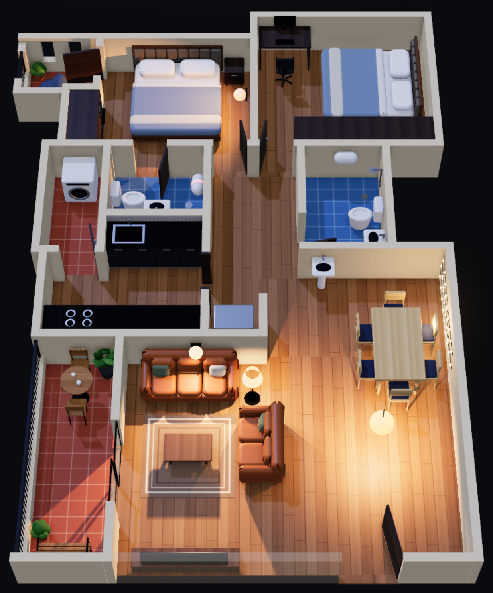
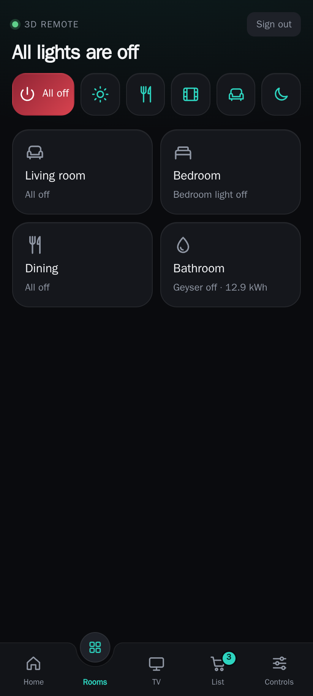
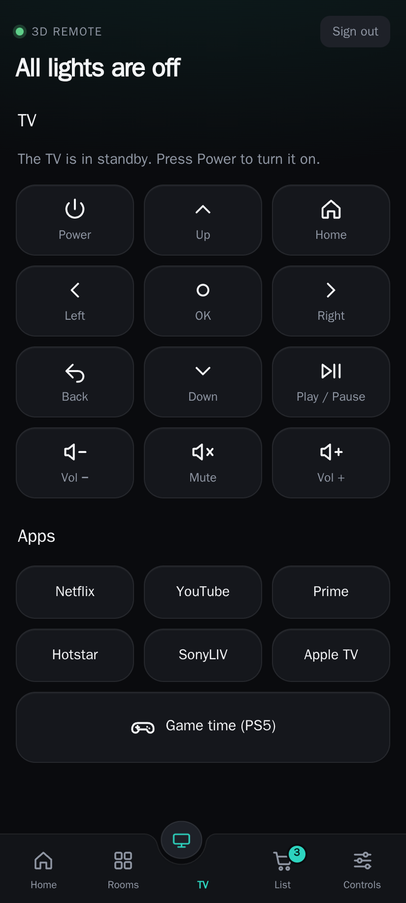
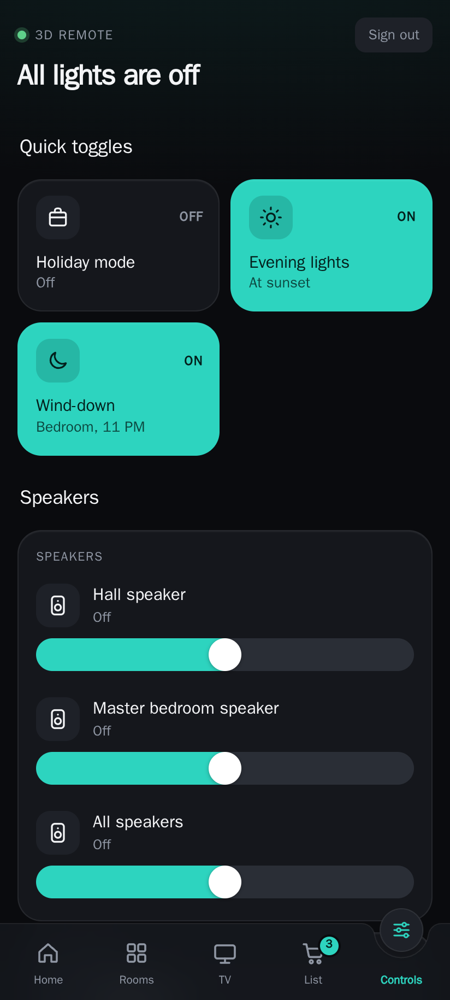

# HA 3D Remote

A phone remote for Home Assistant built around a 3D model of your home. Tap a lamp, the TV or a plug in the model to switch it, and lamps that are on actually light up the room.

It's one HTML file plus [three.js](https://threejs.org). Home Assistant serves it from its `www` folder, so you need no add-on, no extra container and no build step.

  

  
  
  

## What it does

- **3D home:** walls, doors, furniture and lamps are generated from a floor plan written as numbers in `config.js`, with no 3D modelling. Each light is a real light in the scene that follows the bulb's state, brightness and colour. Tap a room to zoom in and see its controls.
- **Scenes row:** one button for all lights, plus your HA scenes.
- **Rooms:** per-room lights with brightness, colours, WiZ-style effect scenes and an optional sleep timer.
- **Plugs:** smart plugs with live watts and an auto-off countdown (made for a water heater).
- **TV remote:** Android TV remote keys, app shortcuts, and an optional "Game time" button.
- **Controls:** quick toggles (holiday mode, automations), speakers with volume, and an optional AdGuard pause button.
- **Shopping list:** HA's to-do list, shared by everyone who signs in.
- **Weather:** shown on the home screen, with a forecast page.
- **Live updates:** it subscribes to HA's WebSocket API, so changes made by voice, wall switches or automations show up within a second.
- **Sign-in:** each person uses their own HA account through HA's normal login page. The token stays in that browser.
- **Installable:** works as an app (PWA) from "Add to Home screen". The download is about 215 KB gzipped, mostly three.js.

## Install

1. Copy this folder into Home Assistant's config folder as `www/ha-3d-remote/`, so you have `/config/www/ha-3d-remote/index.html`.
2. Edit `config.js` (see below).
3. Open `http://<your-ha>:8123/local/ha-3d-remote/index.html` and sign in with your HA account.
4. On your phone, use **Add to Home screen**. On Chrome this needs HTTPS, so open it through your usual HTTPS address for HA.

You don't need to restart HA. After changing a file, bump `VERSION` near the bottom of `index.html`: HA lets browsers cache `/local/` files, and the app reloads itself when the version changes.

## Configure (`config.js`)

Everything about your home is in `config.js`. The app code in `index.html` doesn't need editing.

| Setting | What it is |
|---|---|
| `SCENES` | Scene buttons on the home screen |
| `ROOMS` | Rooms and the lights, plugs and switches in each. The comments explain every option (`dim`, `colour`, `plug`, `power`, `autoOffMin`, `sleep`, `meters`…). A room with `homeOnly: true` becomes the Controls page. |
| `COLOURS` | The colour swatches shown for colour lights |
| `PLAN` | The 3D floor plan, in feet from the top-left corner: `rooms` (rectangles), `walls` (with doors, windows and railings), `furniture`, `rugs` and `lamps` (where each light sits, linked by entity ID). Add `labels: true` to print room names on the floor. |
| `TV` | Android TV entities and helper scripts (below). Leave `game` out to hide the Game time button. |
| `LIST` | A to-do entity for the shopping list |
| `WEATHER` | A weather entity |
| `EXTRA` | Speakers on the Controls page, and the AdGuard pause button (`adguard: null` hides it) |

The example `config.js` is the author's own flat. The easiest way to start is to change the entity IDs first and check the controls work, then redraw `PLAN` room by room.

### What the TV page expects in Home Assistant

- `remote.*` and `media_player.*` from the **Android TV Remote** integration
- `sensor.tv_status`: a template sensor whose state is `On` when the TV is on
- `script.tv_power_toggle`: turns the TV on or off
- `script.tv_open_app`: takes a field `app` (for example `Netflix`) and opens that app
- optional `script.tv_game_time`: whatever "game time" means in your home

### The AdGuard button

It calls `rest_command.adguard_pause` (with `minutes`) and `rest_command.adguard_resume`, and reads the state from a sensor whose state is `paused` while paused. Set `adguard: null` if you don't use AdGuard Home.

## How it's built

- three.js r160, plus official add-ons: GTAO ambient occlusion, Unreal bloom for the glow, and RoomEnvironment for reflections
- Furniture is made from boxes, cylinders and canvas textures generated in code
- Taps are found with a raycaster
- Home Assistant connection: OAuth login, then the WebSocket API (`subscribe_events` for `state_changed`, `call_service`, `todo/item/subscribe`, `weather.get_forecasts`)

## Notes

Provided as-is. It was built for one home, so expect to read `config.js` comments rather than a polished setup screen. Issues and pull requests are welcome, but support is best-effort.

## Licence

MIT, see `LICENSE`. three.js is MIT, see `THREE-LICENSE`.
